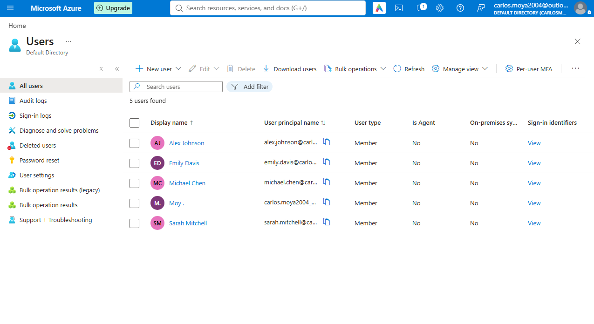
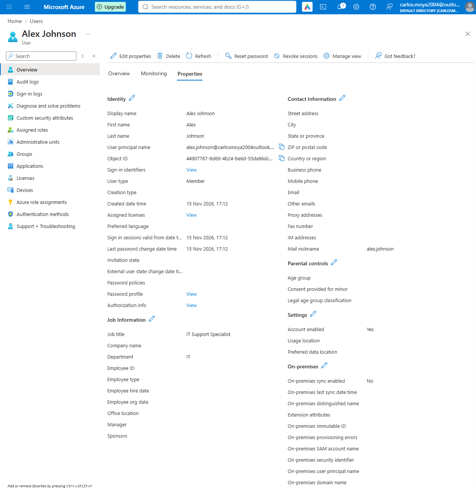
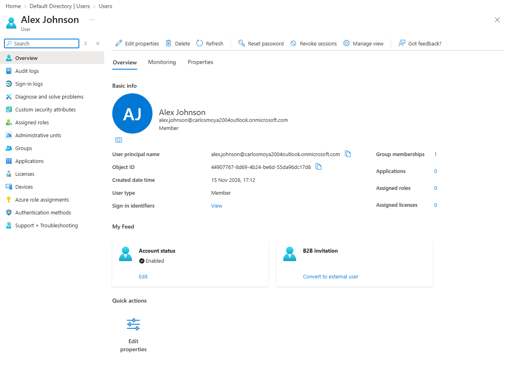
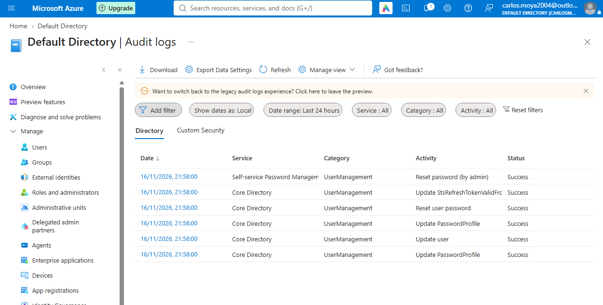

# Microsoft Entra ID Administration Lab

**Identity & Access Management | IT Support | Cloud Administration**

## Project Overview

This project demonstrates hands-on experience administering user identities, security groups, password resets, and account access using **Microsoft Entra ID (formerly Azure Active Directory)**.

The lab simulates common IT Help Desk and IT Support responsibilities in a business environment, including employee account management, access troubleshooting, password administration, and employee offboarding.

All tasks were performed in a Microsoft Entra ID test environment using simulated employee accounts.

## Technologies & Tools

- Microsoft Entra ID
- Microsoft Azure Portal
- Identity and Access Management (IAM)
- Role-Based Access Control (RBAC) concepts
- Microsoft Entra Audit Logs
- Microsoft Entra Sign-in Logs
- Windows 11
- IT Help Desk Ticket Documentation

---

## Lab Objectives

- Create and manage employee user accounts.
- Perform administrator-initiated password resets.
- Create departmental security groups.
- Manage group memberships and user access.
- Simulate employee offboarding procedures.
- Revoke active user sign-in sessions.
- Monitor authentication activity.
- Review audit logs to verify administrative changes.
- Document completed tasks using professional IT support tickets.

---

## 1. User Account Management

**Scenario:** An IT administrator must create and maintain employee accounts for different departments.

### Tasks Performed

- Created simulated employee accounts.
- Reviewed user profiles and account properties.
- Configured employee information, including job titles and departments.
- Verified account status and directory membership.

### Evidence

**Skills Demonstrated:** User provisioning, directory administration, account configuration, and identity management.

---

## 2. Password Reset Administration

**Scenario:** An employee contacts the IT Help Desk because they need assistance resetting their account password.

### Tasks Performed

- Located the employee account in Microsoft Entra ID.
- Initiated an administrator password reset.
- Confirmed successful completion.
- Reviewed audit logs to verify the password reset event.

### Evidence

**Skills Demonstrated:** Password administration, account recovery, security verification, and troubleshooting.

---

## 3. Security Group Management

**Scenario:** Employees require access to departmental resources based on their organizational roles.

### Tasks Performed

- Created security groups for IT, HR, Finance, and Sales.
- Assigned simulated employees to appropriate departmental groups.
- Reviewed group memberships.
- Practiced removing users from security groups.

### Evidence

**Skills Demonstrated:** Security group administration, group-based access management, and least-privilege concepts.

---

## 4. Employee Offboarding

**Scenario:** An employee leaves the organization and IT must remove their access.

### Tasks Performed

- Identified the employee account.
- Removed the employee from a departmental security group.
- Verified the group membership change.
- Revoked the employee's active sign-in sessions.
- Confirmed successful session revocation.

### Evidence

**Skills Demonstrated:** Employee offboarding, access revocation, identity security, and administrative verification.

---

## 5. Sign-In Monitoring

**Scenario:** The IT support team needs to review authentication activity to identify successful and unsuccessful sign-in attempts.

### Tasks Performed

- Accessed Microsoft Entra sign-in logs.
- Reviewed recorded authentication events.
- Inspected sign-in activity details.
- Examined authentication requirements and sign-in status.

### Evidence

**Skills Demonstrated:** Authentication monitoring, sign-in troubleshooting, security log analysis, and identity security awareness.

---

## 6. Audit Log Monitoring

**Scenario:** An IT administrator must verify that account changes and administrative actions were completed successfully.

### Tasks Performed

- Accessed Microsoft Entra audit logs.
- Reviewed administrator-initiated password reset events.
- Inspected affected user accounts.
- Verified successful completion of administrative operations.

### Evidence

**Skills Demonstrated:** Audit log analysis, administrative accountability, change verification, and security monitoring.

---

## Help Desk Ticket Documentation

The project includes simulated IT support scenarios documented using a structured ticketing approach.

Each ticket describes:

1. Reported issue or service request.
2. Affected account or resource.
3. Troubleshooting or administrative actions.
4. Verification of the result.
5. Final ticket resolution.

These reports demonstrate the ability to communicate technical work clearly and document support procedures.

---

## Key Skills Developed

| Technical Skill | Practical Experience |
|---|---|
| Microsoft Entra ID | User and group administration |
| Identity and Access Management | Account lifecycle management |
| Password Administration | Administrator password resets |
| Security Groups | Departmental group membership |
| Employee Offboarding | Group removal and session revocation |
| Authentication Monitoring | Reviewing sign-in activity |
| Audit Logging | Verifying administrative changes |
| IT Documentation | Simulated help desk ticket reports |

---

## Project Outcome

Successfully completed a simulated Microsoft Entra ID administration lab covering common IT support responsibilities.

The project demonstrates practical familiarity with managing cloud-based identities, performing password resets, administering security groups, reviewing authentication logs, and supporting employee account lifecycle processes.

The lab provides hands-on experience relevant to entry-level positions such as:

- IT Support Specialist
- Help Desk Technician
- Desktop Support Technician
- IT Service Desk Analyst
- Junior IT Administrator

---

## Disclaimer

This project was completed in a personal lab environment using simulated employee accounts. It does not represent production enterprise administration or professional employment experience.

Screenshots intended for public viewing should have passwords, sensitive identifiers, and personal information removed or redacted.
